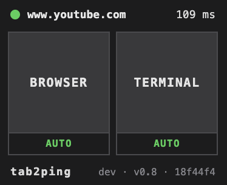
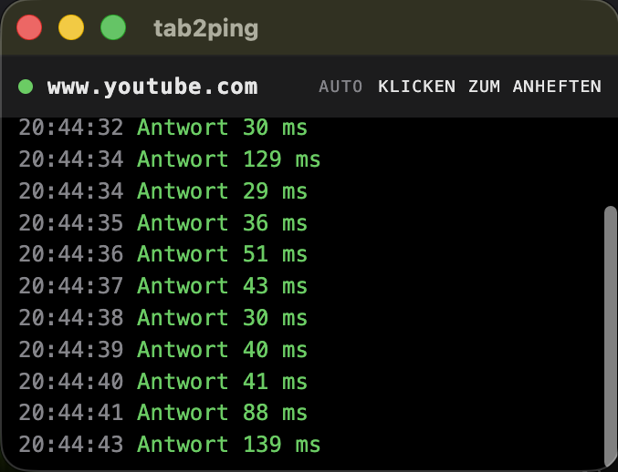

# tab2ping

[English](README.md) · **Deutsch**

Browser-Erweiterung (Brave, Chrome, Edge), die den Host des aktiven Tabs fortlaufend anpingt, damit sich bei Weboberflächen von Geräten im lokalen Netz sofort zeigt, ob das Gerät überhaupt erreichbar ist. Gehört zur Familie von [tab2tv](https://github.com/unbindthefog/tab2tv): Beide halten etwas in Echtzeit mit dem aktiven Tab synchron.

Stand: erste funktionale Version (nur macOS). Die Oberfläche folgt der Sprache des Browsers (Deutsch oder Englisch).

<p>
  
  &nbsp;
  
</p>

## Installation

1. Erweiterung laden: `brave://extensions` → Entwicklermodus → **Entpackte Erweiterung laden** → Ordner `extension/`.
2. Helfer installieren (einmal je macOS-Konto, ohne Admin-Rechte; das Popup zeigt die Zeile auch mit Kopierknopf):
   ```
   curl -fsSL https://github.com/unbindthefog/tab2ping/releases/latest/download/install.sh | sh
   ```
   Entfernen: dieselbe Zeile mit `| sh -s -- --uninstall`.

Ein echter Ping und das Öffnen von Terminal gehen nur über diesen Helfer (`helper/main.swift`), den der Browser per Native Messaging startet. Er führt `/sbin/ping` aus und gibt jede Antwort an die Erweiterung weiter.

## Entwicklung

- Helfer aus dem Quellcode bauen und anmelden (braucht Xcode): `tools/install-helper.sh`, entfernen mit `--uninstall`.
- Test ohne Browser: `node tools/test-helper.mjs`.
- Release vorbereiten: `tools/make-release.sh` legt Helfer und `install.sh` (Version und Prüfsumme eingesetzt) nach `dist/` und nennt den Befehl zum Veröffentlichen.
- Texte: `extension/_locales/de` und `extension/_locales/en`.

Gestaltung: `extension/style.css` ist eine Kopie aus tab2tv.

## Lizenz

MIT, siehe `LICENSE`. Ausgenommen ist die Schrift Tiny5 in `extension/fonts/tiny5/`, sie steht unter der SIL Open Font License 1.1.
