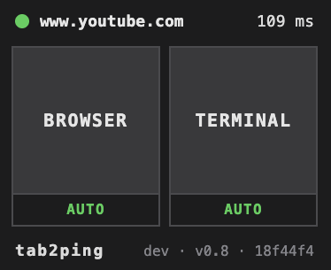
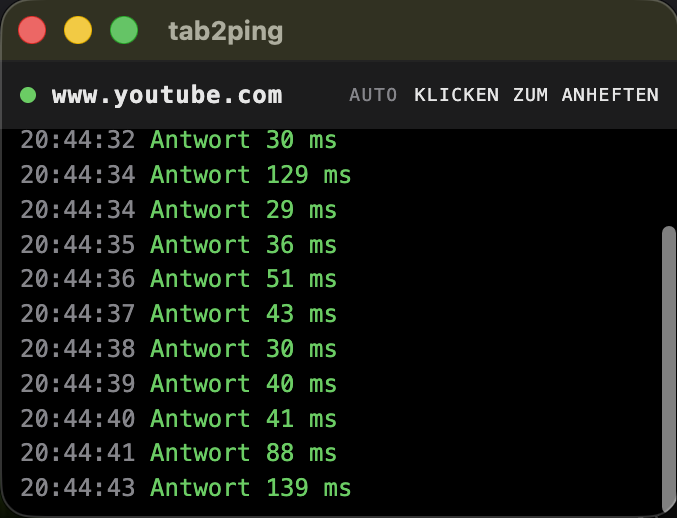

# tab2ping

**English** · [Deutsch](README.de.md)

Browser extension (Brave, Chrome, Edge) that keeps pinging the host of the active tab, so that with the web interfaces of devices in the local network you see at once whether the device is reachable at all. Part of the [tab2tv](https://github.com/unbindthefog/tab2tv) family: both keep something in sync with the active tab, in real time.

Status: first working version (macOS only). The interface follows the browser's language (English or German).

<p>
  
  &nbsp;
  
</p>

## Installation

1. Load the extension: `brave://extensions` → Developer mode → **Load unpacked** → folder `extension/`.
2. Install the helper (once per macOS account, no admin rights; the popup shows the line with a copy button, too):
   ```
   curl -fsSL https://github.com/unbindthefog/tab2ping/releases/latest/download/install.sh | sh
   ```
   Remove: the same line with `| sh -s -- --uninstall`.

A real ping and opening Terminal only work through this helper (`helper/main.swift`), which the browser starts via native messaging. It runs `/sbin/ping` and passes every reply on to the extension.

## Development

- Build the helper from source and register it (needs Xcode): `tools/install-helper.sh`, remove with `--uninstall`.
- Test without a browser: `node tools/test-helper.mjs`.
- Prepare a release: `tools/make-release.sh` puts the helper and `install.sh` (version and checksum filled in) into `dist/` and prints the command to publish.
- Texts: `extension/_locales/en` and `extension/_locales/de`.

Design: `extension/style.css` is a copy from tab2tv.

## License

MIT, see `LICENSE`. Except the Tiny5 font in `extension/fonts/tiny5/`, which is under the SIL Open Font License 1.1.
